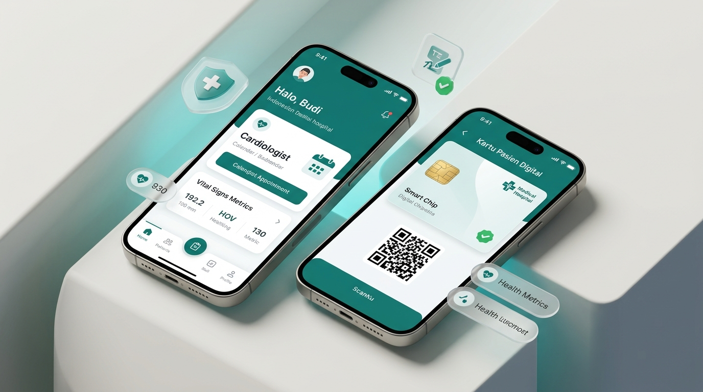
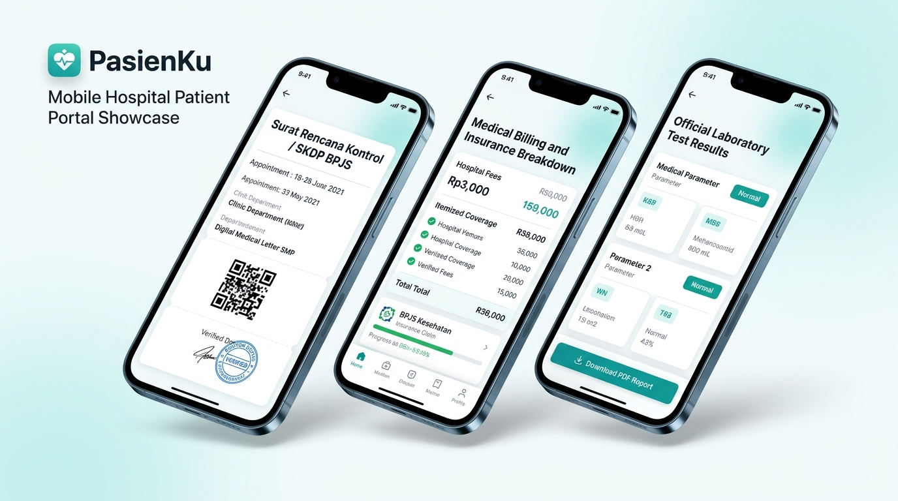

# PasienKu - Portal Mandiri & Mobile Pasien SIMGOS 2

<p align="center">
  
</p>

> **Dikembangkan oleh**: **Suriyandi** (SIRS RSUP dr. Ben Mboi Kupang)  
> Didedikasikan untuk mendukung transformasi digital rekam medis dan kemudahan layanan pasien pada seluruh rumah sakit pengguna **SIMGOS 2** Kementerian Kesehatan RI.

Aplikasi Portal Pasien berbasis web modern responsif & **Progressive Web App (PWA)** kelas rumah sakit modern yang terhubung langsung dengan sistem rekam medis elektronik (RME) dan billing **SIMGOS 2** (Kementerian Kesehatan RI).

Didesain dengan antarmuka berkelas internasional (ala *Apple Health* dan standar aplikasi kesehatan modern) untuk memberikan transparansi informasi perawatan, rincian biaya, jadwal kontrol, antrean poliklinik, serta akses dokumen medis resmi bertandatangan elektronik (TTE).

---

## 🌟 Fitur Utama

1. **Dashboard Kunjungan & Riwayat Rekam Medis (Per Episode)**:
   - Pengelompokan episode rawat jalan / rawat inap terstruktur tanpa kerumitan rujukan internal lab/rad/farmasi.
   - Resume medis DPJP & kode diagnosa ICD-10 terverifikasi.
   - Akses dokumen resume medis PDF resmi dengan QR Code verifikasi.
2. **Dokumen & Surat Medis Resmi (TTE)**:
   - Surat Rencana Kontrol (SKDP BPJS) terintegrasi dengan kode booking antrean.
   - Surat Keterangan Sakit, Surat Sehat, Surat Keterangan Rawat Inap (Opname), Surat Kenal Lahir, dan Surat Traveling Hemodialisa (HD).
   - Penampil PDF terintegrasi (*Built-in PDF Viewer*) dengan fitur zoom, cetak, dan pembesar QR Code APM (*Barcode Scanner Friendly*).
3. **Hasil Pemeriksaan Penunjang (Lab & Radiologi)**:
   - Hasil laboratorium lengkap dengan nilai rujukan, satuan, dan tanda status kritis/normal.
   - Hasil expertise dokter spesialis radiologi (Rontgen, USG, CT-Scan, MRI) beserta kesimpulan klinis.
4. **Transparansi Biaya & Billing Real-time**:
   - Rincian biaya transparan (akomodasi kamar, visite dokter, tindakan medis, lab, radiologi, dan farmasi).
   - Mendukung perhitungan gabung tagihan (*merge billing*) dan kalkulasi akumulasi manfaat klaim penjamin BPJS / Asuransi.
5. **Jadwal Dokter & Ketersediaan Tempat Tidur**:
   - Jadwal praktek dokter spesialis terintegrasi dengan sistem HFIS BPJS & SIMGOS.
   - Ketersediaan tempat tidur rawat inap real-time per kelas dan per ruangan.
6. **Riwayat Terapi Obat & Resep**:
   - Daftar obat pulang/rawat jalan, aturan konsumsi, kuantitas, dan petunjuk pemakaian.
7. **Kartu Pasien Digital (Executive Health Pass)**:
   - Kartu identitas pasien digital resmi rumah sakit dengan Barcode / QR Code No. RM siap scan di mesin APM rumah sakit.

<p align="center">
  
</p>

---

## 🛠️ Arsitektur & Teknologi

- **Frontend**: Single Page Application (SPA) ringan, Vanilla JS modern, Tailwind CSS (CDN), Lucide Icons, dan PWA Service Worker. Sangat cepat, hemat kuota internet pasien, dan tidak memerlukan *build tools* rumit (Node.js/Webpack tidak wajib di server).
- **Backend**: Native PHP RESTful API terstruktur dan aman, PDO Database Abstraction, terintegrasi dengan arsitektur micro-database SIMGOS 2 (`master`, `pendaftaran`, `layanan`, `medicalrecord`, `pembayaran`, `farmasi`, `laporan`, dan `regonline`).
- **Laporan & Dokumen**: Terhubung langsung dengan Document Storage SIMGOS dan JasperReports Web Service engine.

---

## 🚀 Panduan Instalasi (4 Langkah Cepat)

### Langkah 1: Unduh / Clone Repositori
Tempatkan folder `pasien-mobile` ini di dalam struktur web server SIMGOS Anda:
```bash
# Contoh direktori pada instalasi standar SIMGOS 2:
cd /var/www/html/production/webapps/application/
git clone https://github.com/zoneikhlas-tech/pasien-mobile.git pasien-mobile
```
*(Atau pada Windows: `D:\SIMGOS\production\webapps\application\pasien-mobile`)*

### Langkah 2: Salin File Konfigurasi
Masuk ke folder `pasien-mobile`, lalu salin template `db.local.php.example` menjadi `db.local.php`:
```bash
cd pasien-mobile
cp db.local.php.example db.local.php
```

### Langkah 3: Sesuaikan Konfigurasi Database & RS
Buka file `db.local.php` dengan editor teks, lalu sesuaikan:
```php
return [
    // 1. KONEKSI DATABASE MYSQL SIMGOS 2
    'host'           => '10.10.x.x',     // IP Database Server SIMGOS RS Anda
    'port'           => 3306,
    'user'           => 'user_simgos',   // User MySQL
    'pass'           => 'password_anda', // Password MySQL
    'database'       => 'aplikasi',

    // 2. SIMGOS WEBSERVICE URL
    'webservice_url' => 'http://10.10.x.x/webservice',

    // 3. IDENTITAS RS (Opsional - Otomatis terdeteksi dari tabel master.ppk)
    // 'kode_ppk'    => '3372015',       // Kode Faskes / PPK Kemenkes 7 Digit
    // 'nama_rs'     => 'RSUD Dr. Sehat',

    // 4. ZONA WAKTU
    'timezone'         => 'Asia/Jakarta', // 'Asia/Jakarta' (WIB), 'Asia/Makassar' (WITA), 'Asia/Jayapura' (WIT)
    'zona_waktu_label' => 'WIB',
];
```

> [!NOTE]
> File `db.local.php` sudah otomatis terdaftar dalam `.gitignore` sehingga data kredensial database rumah sakit Anda tidak akan pernah bocor ke publik saat melakukan push ke Git repository.

### Langkah 4: Migrasi Tabel Database (`regonline.pasien_auth`)
Aplikasi telah dilengkapi fitur *auto-create table*, namun untuk lingkungan *production* yang membatasi hak akses DDL user database, administrator disarankan mengeksekusi skrip SQL yang telah disediakan:
```bash
mysql -u root -p regonline < database/schema_pasien_auth.sql
```

---

## 🗄️ Skema Database Autentikasi (`regonline.pasien_auth`)

Portal PasienKu mengisolasi kredensial autentikasi pada skema database `regonline` agar terpisah rapi dari data rekam medis utama:

| Kolom | Tipe Data | Keterangan |
| :--- | :--- | :--- |
| `NORM` | `INT(11)` | **Primary Key**. Nomor Rekam Medis pasien (`master.pasien.NORM`). |
| `PIN_HASH` | `VARCHAR(255)` | Hash PIN 6-Digit menggunakan enkripsi satu arah **Bcrypt**. |
| `SALAH_INPUT` | `INT(11)` | Counter kesalahan input PIN berturut-turut (reset ke `0` saat login berhasil). |
| `TERKUNCI_HINGGA` | `DATETIME NULL` | Batas waktu akun dibekukan sementara jika salah memasukkan PIN 5 kali. |
| `TERAKHIR_LOGIN` | `DATETIME NULL` | Timestamp aktivitas login terakhir pasien. |
| `DIBUAT_TANGGAL` | `DATETIME` | Waktu pertama kali pasien melakukan aktivasi PIN. |
| `DIPERBARUI_TANGGAL` | `DATETIME` | Waktu terakhir PIN diubah atau diperbarui. |

DDL lengkap tersedia pada file: [database/schema_pasien_auth.sql](file:///d:/SIMGOS/production/webapps/application/pasien-mobile/database/schema_pasien_auth.sql).

---

## 🌐 Cara Mengakses & Menjalankan

### A. Melalui Web Server Rumah Sakit (Apache / Nginx / IIS / Cloudflare Tunnel)
Aplikasi dapat langsung diakses oleh pasien melalui URL alias:
```
https://pasien.namars.go.id/application/pasien-mobile/
```

### B. Uji Coba Cepat (Local Development)
Jalankan file `start-server.bat` (Windows) atau jalankan PHP built-in server:
```bash
php -S 0.0.0.0:8085
```
Buka browser di `http://localhost:8085`.

---

## 📱 PWA (Install ke Smartphone Pasien)
Pasien dapat mengunduh dan memasang aplikasi ini langsung di layar utama smartphone tanpa melalui Google Play Store atau Apple App Store:
- **Android (Chrome)**: Buka tautan portal -> Ketuk tombol menu (titik tiga) -> Pilih **"Tambahkan ke Layar Utama" / "Install Aplikasi"**.
- **iPhone / iOS (Safari)**: Buka tautan portal -> Ketuk tombol Bagikan (*Share icon*) -> Pilih **"Add to Home Screen"**.

---

## 🔐 Arsitektur Keamanan & Proteksi Data Medis Pasien

Portal PasienKu menerapkan prinsip **Defense in Depth** dan **Privacy by Design** untuk melindungi kerahasiaan data medis pasien sesuai standar kepatuhan regulasi kesehatan:

### 1. Sistem Autentikasi 6-Digit PIN (Bcrypt) & Anti-Brute Force
* Pasien masuk menggunakan kombinasi No. Rekam Medis / NIK KTP dan **6-Digit PIN Pribadi**.
* PIN diamankan menggunakan algoritma enkripsi satu arah standar industri **Bcrypt** (`PASSWORD_BCRYPT`).
* **Proteksi Lockout**: Jika terjadi kesalahan input PIN sebanyak **5 kali berturut-turut**, akun secara otomatis dibekukan (*locked*) selama **15 menit** demi melindungi rekam medis dari serangan tebak PIN / *dictionary attack*.

### 2. Kebijakan Aktivasi & Reset PIN Ketat (Opsi 3)
* **Aktivasi Pasien Baru**: Pasien yang baru pertama kali mengakses portal diwajibkan melakukan verifikasi identitas (Kecocokan Tanggal Lahir dan 4 Digit Terakhir No. HP terdaftar di RS).
* **Anti-Reset dari Publik**: Demi mencegah pembajakan akun dan rekam medis oleh pihak yang mengetahui data KTP pasien, **tombol lupa PIN mandiri di halaman login ditiadakan**. Akun yang sudah memiliki PIN aktif **tidak dapat di-reset dari publik luar**.
* **Ubah PIN Mandiri**: Pengubahan PIN hanya dapat dilakukan dari dalam menu **Profil & Kartu** setelah pasien berhasil login (wajib memasukkan PIN lama).
* Pasien yang benar-benar lupa PIN dapat melakukan verifikasi fisik tatap muka di Loket Admisi / Rekam Medis RS.

### 3. Stateless HMAC Verification Token
* Untuk menjamin kestabilan alur aktivasi akun saat diakses melalui arsitektur multi-server, reverse proxy, atau **Cloudflare Tunnel**, penerbitan token sesi verifikasi menggunakan kriptografi **HMAC-SHA256** bertenggang waktu 30 menit (`verify_token`).

### 4. Pencegahan IDOR / BOLA pada Dokumen Medis PDF
* Seluruh endpoint unduh/stream dokumen PDF (Resume Medis, Surat Keterangan Sakit, Surat Sehat, Surat Kontrol SKDP, Hasil Laboratorium, dan Hasil Radiologi) menerapkan **verifikasi otorisasi kepemilikan ketat**.
* Sistem memastikan kunjungan dan tindakan medis yang diminta terikat langsung dengan `NORM` pasien yang terotentikasi di sesi. Akses ke dokumen milik pasien lain otomatis ditolak dengan status **HTTP 403 Forbidden**.

### 5. Pengerasan Session Cookie & HTTP Security Headers
* **Cookie Flags**: Menggunakan nama sesi mandiri `SIMGOS_PASIEN_SESS` dengan parameter `HttpOnly` (mencegah pencurian cookie via XSS), `SameSite=Lax` (anti-CSRF), dan `Secure` (wajib HTTPS).
* **Anti-Session Fixation**: Fungsi `session_regenerate_id(true)` otomatis dieksekusi saat login PIN dan aktivasi PIN berhasil.
* **Inactivity Auto-Logout (30 Menit)**: Sesi login pasien otomatis berakhir jika tidak ada aktivitas selama 30 menit demi mencegah kebocoran data saat gawai ditinggalkan.
* **HTTP Headers**:
  * `X-Frame-Options: SAMEORIGIN` (Anti-Clickjacking / pencegahan iframe luar).
  * `X-Content-Type-Options: nosniff` (Anti-MIME Sniffing).
  * `Referrer-Policy: strict-origin-when-cross-origin`.
  * `Permissions-Policy: camera=(), microphone=(), geolocation=()`.
  * **CORS**: Dibatasi ketat hanya untuk domain resmi rumah sakit.

### 6. Rate Limiting & Anti-Enumeration (Anti-Scraping)
* Endpoint pencarian identitas (`check_identifier`) dibatasi maksimal **20 request/menit per IP** untuk menggagalkan bot/skrip yang mencoba menebak No. RM secara massal.
* Endpoint verifikasi identitas dibatasi **15 request/menit per IP**, dan login PIN dibatasi **30 request/menit per IP**.
* **Penyensoran Nama Pra-Login**: Sebelum PIN dimasukkan, backend hanya menampilkan inisial/nama tersensor (contoh: `"NADRAENI P. Y."`). Nama lengkap dan rincian data hanya disajikan setelah pasien berhasil lolos verifikasi PIN.
* **Perlindungan Privasi Kontak**: Backend tidak pernah membocorkan digit nomor kontak pasien ke browser publik.

---

## 👨‍💻 Pengembang (Developer)

* **Pengembang**: **Suriyandi**
* **Unit Kerja**: Sistem Informasi Rumah Sakit (SIRS)
* **Instansi**: RSUP dr. Ben Mboi Kupang, Nusa Tenggara Timur
* **Deskripsi**: Inisiator & arsitek pengembang modul portal mobile mandiri pasien (PasienKu) berbasis web responsif & PWA yang terintegrasi penuh dengan arsitektur micro-database SIMGOS 2.

---

## 📄 Lisensi & Kontribusi
Aplikasi ini dikembangkan untuk mendukung ekosistem digitalisasi rumah sakit pengguna **SIMGOS 2** Kementerian Kesehatan RI. Terbuka untuk kontribusi fitur, pelaporan kendala (*issues*), dan penyesuaian kebutuhan rumah sakit di seluruh Indonesia.
